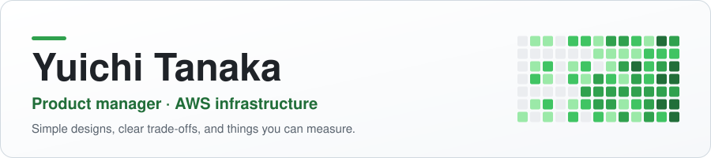
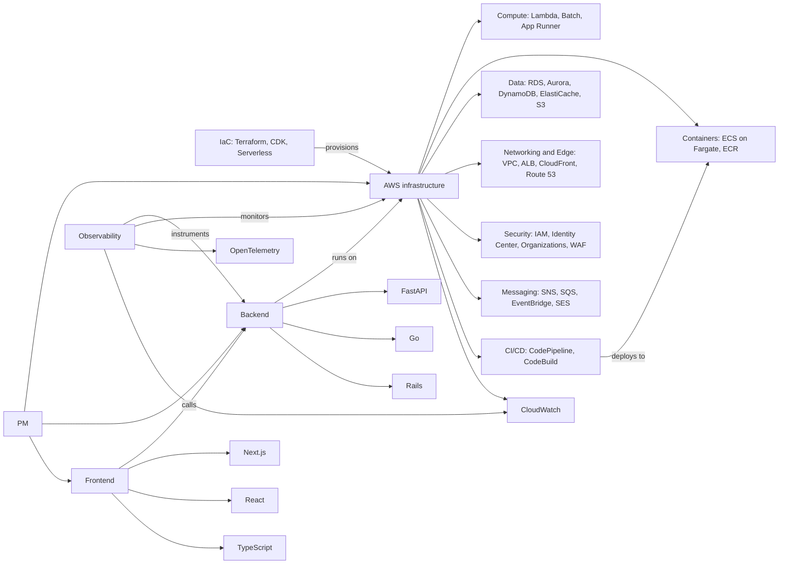
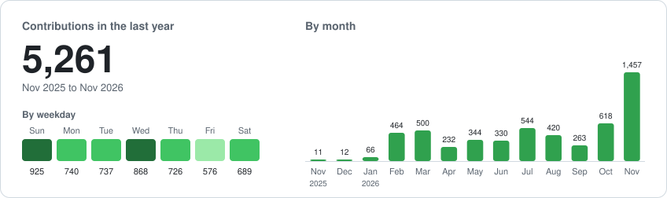

<picture>
  <source media="(prefers-color-scheme: dark)" srcset="https://raw.githubusercontent.com/yuichi-tanaka-1013/yuichi-tanaka-1013/main/assets/header-dark.svg">
  
</picture>

Product manager with a long background in AWS infrastructure. I also write backend and frontend code.

I care about simple designs, clear trade-offs, and things you can measure.

> [!NOTE]
> The cards on this page are drawn by a small Python script in this repo and refreshed every day by GitHub Actions. They use no external services.

## What I do

- Designed and built all of my company's AWS infrastructure on my own, as code: Terraform for most systems, plus AWS CDK and Serverless Framework
- Run containers on ECS Fargate behind ALB, with CI/CD on CodePipeline and CodeBuild
- Set up multi-account AWS with Organizations and IAM Identity Center
- Build backends with FastAPI, Go and Rails, and frontends with Next.js and React
- Lead projects as a PM: requirements, design, and delivery
- Add observability with OpenTelemetry and CloudWatch

How these areas connect to the tools I use:



## AWS

Every service below appears in infrastructure code I wrote (Terraform, AWS CDK or Serverless Framework).

| Category | Services |
|---|---|
| Compute | AWS Lambda · AWS Batch · Amazon EC2 · AWS App Runner |
| Containers | Amazon ECS on AWS Fargate · Amazon ECR · Application Auto Scaling · AWS Cloud Map |
| Data | Amazon RDS (PostgreSQL, MySQL) · Amazon Aurora · Amazon DynamoDB · Amazon ElastiCache · Amazon S3 · Amazon EFS · Amazon Data Firehose · AWS Glue Data Catalog · Amazon Athena |
| Networking & Edge | Amazon VPC (NAT Gateway, VPC endpoints, Flow Logs) · Elastic Load Balancing (ALB, NLB) · Amazon CloudFront (CloudFront Functions, Lambda@Edge) · Amazon Route 53 · Amazon API Gateway (REST, HTTP) |
| Security & Identity | AWS IAM · AWS IAM Identity Center · AWS Organizations · AWS Certificate Manager · AWS WAF · AWS Secrets Manager · AWS Systems Manager Parameter Store · AWS KMS · Amazon Cognito · Amazon GuardDuty (Malware Protection for S3) · AWS CloudTrail |
| Observability | Amazon CloudWatch (Logs, Alarms, Dashboards, Container Insights, cross-account observability) · Amazon Managed Grafana · AWS Chatbot (Slack) · AWS Billing and Cost Management (cost allocation tags, billing alarms) |
| Delivery / CI-CD | AWS CodePipeline · AWS CodeBuild · AWS CodeConnections (GitHub) · AWS CodeStar Notifications · GitHub Actions with OIDC to IAM |
| Messaging & Integration | Amazon SNS · Amazon SQS · Amazon EventBridge · Amazon EventBridge Scheduler · Amazon SES |
| IaC | Terraform (per-environment state in S3, DynamoDB locking) · Terragrunt · AWS CDK · AWS CloudFormation · Serverless Framework |

### Patterns

- Multi-account AWS with Organizations and IAM Identity Center, plus cross-account roles
- Containers on ECS Fargate behind ALB with ACM certificates; ECS Exec for operations; Container Insights
- CI/CD with CodePipeline and CodeBuild: build images to ECR, then roll out to ECS; pipeline notifications to Slack through SNS and AWS Chatbot
- Static sites on S3 and CloudFront (OAC/OAI, CloudFront Functions), with AWS WAF where needed
- Secrets in SSM Parameter Store (SecureString) and Secrets Manager, injected into tasks at runtime
- Scheduled jobs with EventBridge rules and EventBridge Scheduler
- Subnets across multiple AZs, Multi-AZ RDS in production, and NAT with S3 gateway endpoints for private subnets
- Arm64 (Graviton) for Fargate tasks, CodeBuild and Lambda

## Tech


## Activity

<picture>
  <source media="(prefers-color-scheme: dark)" srcset="https://raw.githubusercontent.com/yuichi-tanaka-1013/yuichi-tanaka-1013/output/stats-dark.svg">
  
</picture>

<picture>
  <source media="(prefers-color-scheme: dark)" srcset="https://raw.githubusercontent.com/yuichi-tanaka-1013/yuichi-tanaka-1013/output/grass-dark.svg">
  
</picture>

<details>
<summary>How these cards are made</summary>

- A GitHub Actions workflow (`.github/workflows/update-cards.yml`) runs once a day and on demand.
- It reads the contribution calendar with the built-in `GITHUB_TOKEN`. No secret is stored in this repo.
- `scripts/profile_cards.py` draws the four SVG files. It reads only the year's total and, for each day, the date, weekday, count and level. It never reads repository names, languages or times of day.
- The workflow runs the tests first, and it updates the cards only when the tests pass. It commits the SVG files to the `output` branch only when they change.
- The four daily cards exist only on `output`. `main` does not receive them. The header and badge SVGs under `assets/` on `main` are static: `scripts/build_assets.py` writes them. When a color, a label or a size changes, run `python3 scripts/build_assets.py` to rebuild them.
- The images load from `raw.githubusercontent.com` and nowhere else. No external service, font or script is involved.

To draw the cards on your own machine:

```sh
gh api graphql -f query="$(python3 scripts/profile_cards.py --print-query)" -f login=yuichi-tanaka-1013 > graphql.json
python3 scripts/profile_cards.py --input graphql.json --out-dir out
```

The tests run with `python3 -m unittest discover -s tests -v`.

</details>
